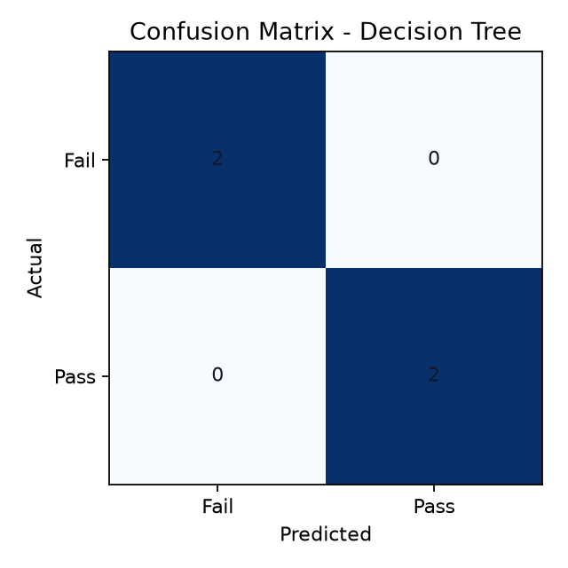

# Student Performance Prediction System

ML-powered student performance prediction system. Train models, evaluate accuracy, and make real-time predictions via a Flask web interface.

## What it does

- Trains three scikit-learn classifiers — Random Forest, Logistic Regression, and Decision Tree — on `dataset/students.csv` to predict whether a student will pass or fail.
- Preprocesses the data with a scikit-learn pipeline: a `ColumnTransformer` with `OneHotEncoder` for categorical features, with numeric features passed through.
- Evaluates each model with the accuracy score, classification report, and confusion matrix.
- Saves the trained best model to `model/model.pkl`, the evaluation metrics to `model/metrics.json`, and a confusion-matrix plot to `static/metrics.png`.
- Serves real-time predictions through a Flask web app: fill in a student's details and get a PASS or FAIL result.

## Tech stack

- Python
- Flask — web app (`app.py`, `templates/index.html`)
- pandas and NumPy — data handling
- scikit-learn — model training, preprocessing, and evaluation
- Matplotlib — confusion-matrix plot

Full dependency list: see `requirements.txt`.

## Project structure

```
student-performance-predictor/
├── app.py               # Flask web app (entry point)
├── requirements.txt     # Python dependencies (pinned)
├── requirements-dev.txt # + pytest for the test suite
├── dataset/
│   └── students.csv     # training data (20-row sample)
├── model/
│   ├── train_model.py   # model training and evaluation script
│   ├── model.pkl        # trained model (generated, not committed)
│   └── metrics.json     # evaluation metrics (generated)
├── static/
│   ├── metrics.png      # confusion-matrix plot (generated)
│   └── ui-preview.svg   # illustration of the form (not a screenshot)
├── templates/
│   └── index.html       # prediction form page
└── tests/
    ├── conftest.py
    ├── test_app.py
    └── test_train_model.py
```

## How to run

1. Install dependencies:
   ```
   pip install -r requirements.txt
   ```
2. Train the models (reads `dataset/students.csv`, writes `model/model.pkl`, `model/metrics.json`, and `static/metrics.png`):
   ```
   python model/train_model.py
   ```
3. Start the web app:
   ```
   python app.py
   ```
   Then open the URL printed in the terminal (Flask's default is http://127.0.0.1:5000/).

On the web page, enter the student's gender, parental education, study time, attendance, failures, and previous grade, then submit the form to get a PASS or FAIL prediction.

## Evaluation

**Read this before quoting any number.** The bundled `dataset/students.csv`
has only **20 rows** (12 pass, 8 fail) and is trivially separable — study
time, attendance and previous grade almost perfectly determine the outcome.
So every model scores near-perfect on it, and none of these numbers mean
anything about real students. Replace the dataset with the official UCI
Student Performance data for real-world results.

Model selection uses **5-fold stratified cross-validation over the full
dataset**, because the 80/20 holdout test set is only 4 rows. Results from
the last training run (`model/metrics.json`):

| Model | CV accuracy (5-fold) | Holdout accuracy (4 rows) |
|---|---|---|
| Decision Tree | 1.00 ± 0.00 | 1.00 |
| Logistic Regression | 0.95 ± 0.10 | 1.00 |
| Random Forest | 0.95 ± 0.10 | 1.00 |

The Decision Tree is saved as the best model because it has the highest CV
accuracy. The 1.00 holdout figure is listed for completeness only — on a
4-row test set it proves nothing.



## Tests

```bash
pip install -r requirements-dev.txt
python -m pytest tests/ -v
```

10 tests cover the preprocessing pipeline, the evaluation and
cross-validation helpers, a full training run, and the Flask app (home page,
PASS/FAIL predictions, and rejected invalid input).

## License

MIT — see `LICENSE`.
